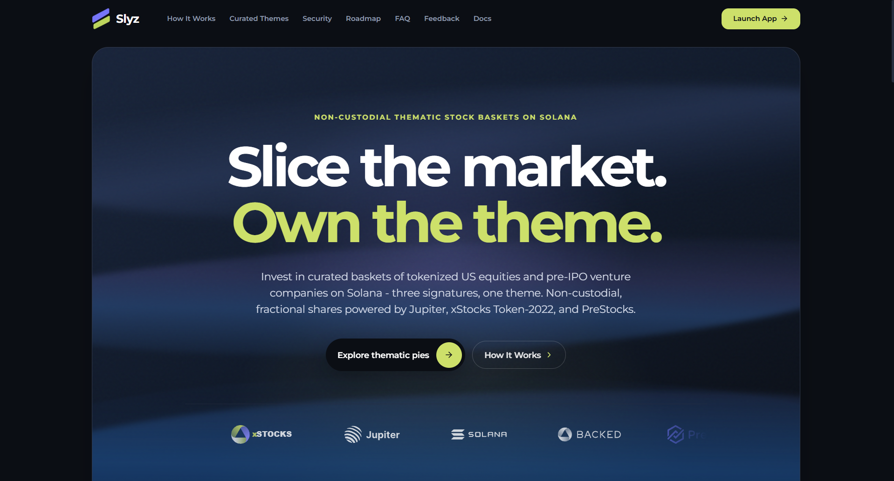

<div align="center">
  
  <h1>Slyz</h1>
  <p><strong>Slice the market. Own the theme.</strong></p>
  <p><em>Non-custodial thematic stock basket investing, Pre-IPO equity access, and on-chain stock gifting on Solana.</em></p>

  <p>
    <a href="https://www.useslyz.xyz"></a>
    <a href="https://t.me/Useslyz"></a>
    
    
    
    
    
  </p>
</div>

---

<div align="center">
  
  <br /><br />
  <p>
    🌐 <strong>Live Application:</strong> <a href="https://www.useslyz.xyz"><strong>https://www.useslyz.xyz</strong></a>
    &nbsp;&nbsp;|&nbsp;&nbsp;
    💬 <strong>Community Support:</strong> <a href="https://t.me/Useslyz"><strong>t.me/Useslyz</strong></a>
    &nbsp;&nbsp;|&nbsp;&nbsp;
    📬 <strong>Contact:</strong> <a href="mailto:support@useslyz.xyz"><strong>support@useslyz.xyz</strong></a>
  </p>
</div>

---

## What is Slyz?

Slyz is a decentralized neo-brokerage application built on Solana. It allows anyone with a Solana wallet to invest in curated stock baskets, access late-stage pre-IPO venture companies, and gift real stock shares to friends with a shareable claim link.

Traditional investing is gated by geographic borders, accredited investor requirements, and slow settlement cycles. Slyz solves this by packaging tokenized public equities (xStocks) and private market secondaries (PreStocks) into a single, clean interface powered by Jupiter swap routing and non-custodial Solana vaults.

---

## Key Highlights

1. **1-Click Thematic Baskets**: Invest in full market sectors (such as Big Tech, AI Infrastructure, or US Indices) in a single click. Slyz calculates target weights, executes sequential swaps through Jupiter, and delivers the underlying assets directly into your wallet.
2. **Pre-IPO Private Market Access**: Access secondary market exposure to leading private companies like SpaceX, OpenAI, Anthropic, Anduril, and Stripe before they go public.
3. **Non-Custodial Stock Gifting**: Create an expiring claim link to gift any public or private stock. The recipient can claim their shares into any Solana wallet without needing any SOL for network fees.
4. **Token-2022 Native Math**: Handles Solana Token-2022 transfer fee hooks, 9-decimal precision, and dynamic scaled UI multipliers automatically so balances and receipts always match on-chain reality.
5. **Smart Rebalancing and Exits**: Track portfolio drift against target weights in real time. Rebalance using top-up water-filling without triggering taxable selling events, or liquidate holdings back into USDC with sequential routing.

---

## Product Pillars

### 1. Thematic Baskets

Instead of manually researching individual tickers and making repeated trades, users can pick a curated thesis:

| Basket | Market Sleeve | Assets & Weights | Investment Thesis |
| :--- | :--- | :--- | :--- |
| **The Mag 3** | Public (xStocks) | NVDA 40%, AAPL 30%, MSFT 30% | Core mega-cap computing, AI hardware, and mobile infrastructure. |
| **The Index** | Public (xStocks) | SPY 50%, QQQ 30%, AAPL 20% | Broad US equity market and NASDAQ large-cap technology blend. |
| **AI Frontier** | Public (xStocks) | NVDA 40%, MSFT 30%, GOOGL 30% | Full-stack artificial intelligence exposure across compute and hyperscalers. |
| **High Beta** | Public (xStocks) | TSLA 40%, NVDA 30%, COIN 30% | High-volatility market momentum across electric vehicles, chips, and crypto. |
| **Big Commerce** | Public (xStocks) | AMZN 40%, META 30%, GOOGL 30% | Global digital advertising leaders and e-commerce logistics networks. |
| **Frontier** | Private (PreStocks) | OpenAI 40%, Anthropic 35%, SpaceX 25% | Direct exposure to the world's most valuable private technology leaders. |

Users can also open the **Custom Studio** to design their own pie with custom weights and live allocation donut charts.

---

### 2. Pre-IPO Private Equities (PreStocks)

Slyz integrates the PreStocks protocol on Solana, making secondary private markets accessible to everyday Web3 users.

- **Verified Mint Contracts**: All 8 private equity mints are verified against official protocol contracts (OpenAI, Anthropic, SpaceX, Anduril, Figure AI, Kalshi, Neuralink, and Polymarket).
- **Transfer Fee Awareness**: Token-2022 enforces a 1% (100 bps) transfer fee hook on PreStocks transactions. Slyz computes these net fee deductions upfront before any swap or transfer is confirmed.
- **Dynamic Multiplier Resolution**: The app dynamically queries live mint extensions (`scaledUiAmountConfig`) directly from the Solana runtime to prevent multiplier drift.
- **Liquidity Impact Guard**: To protect users from thin AMM liquidity pools, orders enforce slippage checks and per-leg size limits.
- **Server Proxy Route**: Live pricing is fetched via `/api/prestocks` with a 3-tier fallback (live proxy, browser cache, authentic baseline) ensuring pricing remains accessible at all times.

---

### 3. Non-Custodial Stock Gifting

Slyz introduces a link-based stock gifting system on Solana:

```
Sender Flow:
1. Sender selects stock, amount, personal note, and expiry duration.
2. Browser generates an ephemeral vault Keypair on Solana.
3. Transaction bundles SOL funding (0.0035 SOL) and token transfer into the vault.
4. Ephemeral keys and metadata are encrypted client-side.
5. Sender shares the unique link: https://www.useslyz.xyz/gift/claim#gift=...

Recipient Claim Flow:
1. Recipient opens link on phone or desktop.
2. Connects any Solana wallet (even an empty wallet with 0 SOL).
3. The ephemeral vault signs the transaction to create the recipient's ATA.
4. Vault transfers shares, closes the escrow, and sweeps remaining SOL to the recipient.
5. On-chain signature is verified and recorded with confirmed status.
```

- **Zero Fees for Recipient**: The recipient does not need to own SOL. The temporary vault pays for account creation, network fees, and rent.
- **Reclaim Protection**: If a link expires unclaimed, the creator can reclaim the deposited shares and SOL back into their wallet.
- **On-Chain Settlement Verification**: Server-side verification confirms that claim transactions successfully decremented vault balances on Solana before marking records settled.
- **Key Destruction**: Once claimed or reclaimed, encrypted secrets are permanently cleared.

---

## Project Structure & Architecture Map

Below is the directory map and functional organization of the Slyz codebase:

```
slyz/
├── src/
│   ├── app/                                 Next.js 14 App Router
│   │   ├── layout.tsx                       Root layout, font, metadata, wallet provider
│   │   ├── page.tsx                         Landing page with interactive hero and themes
│   │   ├── dashboard/page.tsx               Stock explorer, swap terminal, Custom Studio
│   │   ├── portfolio/page.tsx               Holdings breakdown, drift tracker, rebalancing
│   │   ├── gift/
│   │   │   ├── page.tsx                     Gift Hub (create gifts, sent vault tracker)
│   │   │   └── claim/page.tsx               Recipient claim page (countdown, gasless claim)
│   │   ├── invest/[basketId]/page.tsx       Sequential multi-leg basket execution page
│   │   ├── docs/page.tsx                    System documentation and guides
│   │   ├── feedback/page.tsx                User feedback and issue reporting form
│   │   ├── terms/page.tsx                   Terms of service and risk disclosures
│   │   ├── privacy/page.tsx                 Privacy policy
│   │   └── api/                             Serverless Backend Endpoints
│   │       ├── gifts/route.ts               Gift creation, wallet-signed GET, authenticated PATCH
│   │       ├── gifts/[id]/route.ts          Public gift metadata endpoint for claim page
│   │       ├── prestocks/route.ts           Server-side CORS proxy for live PreStocks data
│   │       └── feedback/route.ts            Feedback intake endpoint with Telegram alerts
│   │
│   ├── components/                          Reusable UI Components
│   │   ├── Navbar.tsx                       Navigation bar with route indicators and wallet button
│   │   ├── Footer.tsx                       Footer with links, socials, and legal disclosures
│   │   ├── GiftStockModal.tsx               Stock gift creation modal (link and direct transfer)
│   │   ├── GiftCountdownClock.tsx           Theme-matched countdown timer
│   │   ├── ExecutionModal.tsx               Sequential swap execution modal with Jupiter
│   │   ├── LiquidationModal.tsx             Sequential portfolio exit to USDC
│   │   ├── StockDetailModal.tsx             Stock details, charts, and single swap interface
│   │   ├── WalletContextProvider.tsx        Solana wallet adapter configuration
│   │   └── TechLogosMarquee.tsx             Partner logo showcase
│   │
│   ├── lib/                                 Core Logic & Utility Libraries
│   │   ├── constants.ts                     Verified stock registries (xStocks and PreStocks)
│   │   ├── gifting.ts                       Vault creation, claim, reclaim, fee math
│   │   ├── jupiter.ts                       Jupiter Lite API integration and swap builder
│   │   ├── solana.ts                        Solana RPC helpers and Token-2022 parsers
│   │   ├── portfolio.ts                     Position valuation and drift calculation
│   │   ├── prestocks.ts                     PreStocks client with failover architecture
│   │   ├── crypto.ts                        AES-256-GCM encryption for link secrets
│   │   ├── walletAuth.ts                    Ed25519 detached signature verification
│   │   ├── walletAuthClient.ts              Client wallet session caching
│   │   ├── supabaseServer.ts                Secure Supabase administrative client
│   │   └── supabaseClient.ts                Client-side Supabase configuration
│   │
│   └── styles/
│       └── globals.css                      Tailwind stylesheet, animations, design tokens
│
├── public/                                  Static Assets
│   ├── slyzlogo.png                         App logo and favicon
│   ├── slyz-preview.png                     Updated landing page hero screenshot
│   ├── og-image.png                         Social preview image
│   └── *.svg                                Solana, Jupiter, xStocks, and PreStocks logos
│
├── scripts/
│   └── verify-mints.mjs                     Pre-deploy verification of on-chain mints
│
├── .env.example                             Environment variable template
├── package.json                             Dependencies and scripts
├── tailwind.config.js                       Tailwind CSS tokens and breakpoints
└── tsconfig.json                            TypeScript compiler settings
```

---

## Architectural Data Flow

```
                      +-----------------------------+
                      |       User Solana Wallet    |
                      |   (Phantom, Solflare, etc.) |
                      +--------------+--------------+
                                     |
               +---------------------+---------------------+
               |                     |                     |
      [1. Basket Swaps]     [2. Gifting Escrow]    [3. Portfolio Reads]
               |                     |                     |
      +--------v--------+   +--------v--------+   +--------v--------+
      |  Jupiter Ultra  |   | Ephemeral Vault |   |   Solana RPC    |
      |   Lite Router   |   |   (Token-2022)  |   | (Alchemy Engine)|
      +--------+--------+   +--------+--------+   +--------+--------+
               |                     |                     |
               +---------------------+---------------------+
                                     |
                         +-----------v-----------+
                         | Solana Mainnet-Beta   |
                         |  Token-2022 Program   |
                         +-----------------------+
```

---

## Security Model

| Principle | Technical Implementation |
| :--- | :--- |
| **Non-Custodial** | Slyz never holds user assets or private keys. Every swap, gift deposit, and liquidation is signed directly by the user's connected wallet. |
| **Client-Side Vault Secrets** | Gift secret keys are serialized within the browser URL hash fragment (`#gift=...`). Hash fragments are never sent over HTTP to web servers. |
| **On-Chain Claim Authentication** | Status updates to `claimed` require an on-chain transaction signature verified to have decremented the specific vault's token balance. |
| **Secret Key Purge** | Once a gift is claimed or reclaimed on-chain, encrypted vault records are permanently set to null in the database. |
| **Pre-Flight Simulation** | Every transaction is simulated through the Solana RPC before the user is prompted to sign, catching insufficient balances, frozen accounts, or paused tokens before any network fee is spent. |
| **Token-2022 Fee Protection** | Protocol transfer fees (such as 100 bps on PreStocks) are calculated prior to execution so users are never surprised by net share receipts. |

---

## Getting Started

### Prerequisites

- Node.js (version 18.17 or higher)
- npm, pnpm, or yarn
- A Solana wallet funded with SOL and USDC on Mainnet-Beta

### 1. Clone the Repository

```bash
git clone https://github.com/Cryptojigi/slyz.git
cd slyz
```

### 2. Install Dependencies

```bash
npm install --ignore-scripts
```

### 3. Configure Environment Variables

Create a local environment file from the example template:

```bash
cp .env.example .env.local
```

Populate the required configuration variables:

```env
# Primary Solana RPC endpoint
NEXT_PUBLIC_ALCHEMY_RPC_URL=https://solana-mainnet.g.alchemy.com/v2/YOUR_API_KEY
NEXT_PUBLIC_SOLANA_NETWORK=mainnet-beta

# Jupiter API endpoint
NEXT_PUBLIC_JUPITER_API_URL=https://lite-api.jup.ag

# Public domain
NEXT_PUBLIC_APP_URL=https://www.useslyz.xyz

# Supabase database configuration
NEXT_PUBLIC_SUPABASE_URL=https://YOUR_PROJECT_ID.supabase.co
NEXT_PUBLIC_SUPABASE_ANON_KEY=YOUR_PUBLISHABLE_KEY
SUPABASE_SERVICE_ROLE_KEY=YOUR_SERVICE_ROLE_KEY
GIFT_SECRET_KEY=YOUR_64_CHAR_HEX_SECRET_KEY

# Optional WalletConnect / Reown Cloud Project ID
NEXT_PUBLIC_WC_PROJECT_ID=YOUR_PROJECT_ID

# Support and Telegram community links
NEXT_PUBLIC_TELEGRAM_SUPPORT_URL=https://t.me/Useslyz
NEXT_PUBLIC_SUPPORT_EMAIL=support@useslyz.xyz
```

### 4. Verify On-Chain Mint Configuration

Run the pre-deploy verification script to validate all 18 stock mint addresses against the live Solana blockchain:

```bash
node scripts/verify-mints.mjs
```

### 5. Start Development Server

```bash
npm run dev
```

Visit [http://localhost:3000](http://localhost:3000) to view the application locally.

### 6. Build for Production

```bash
npm run build
npm run start
```

---

## Official Channels

- **Live Application:** [https://www.useslyz.xyz](https://www.useslyz.xyz)
- **Telegram Community:** [@Useslyz](https://t.me/Useslyz)
- **Email Support:** [support@useslyz.xyz](mailto:support@useslyz.xyz)
- **Documentation:** [https://www.useslyz.xyz/docs](https://www.useslyz.xyz/docs)

---

## License

Distributed under the MIT License. See [LICENSE](./LICENSE) for more information.
